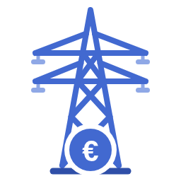

<h1 align="center">PVPC + Bono Social</h1>

<b>Precios horarios del PVPC y tu factura de la luz, al céntimo, con o sin bono social, en Home Assistant.</b> 
Spanish PVPC hourly prices and your electricity bill, to the cent, with or without the social bonus. 
<a href="https://github.com/BaRDaHL/pvpc_bonosocial/wiki">Wiki</a>

---

Conoce **tu factura de la luz antes de que llegue**: precios horarios del PVPC *y* la factura de la comercializadora de referencia (COR) rehecha línea a línea, con el **bono social**, los impuestos y los fijos.

### Por qué instalarla

- 🎯 **Exacta al céntimo**: reproduce **21 de 21 facturas reales** (de diciembre de 2024 a septiembre de 2026). Con un medidor en casa, la factura estimada se desvió **0,45 € de media** en 8 facturas.
- 💡 **Bono social completo**: descuento, límite anual de kWh y arrastre de los kWh no gastados en 12 meses.
- ⚡ **Precios por horas de hoy y mañana**: periodos, niveles de precio, horas más baratas, mínimo, máximo y media, y API privada de ESIOS opcional.
- 📊 **Coste real en el panel de Energía**, con impuestos y fijos, corregido al llegar la factura.
- 📄 **Sube la factura desde la tarjeta** (un PDF, varios o un ZIP; o a mano): se lee en local, recalibra el medidor y el saldo del bono.
- 🔍 **Segunda opinión de la CNMC** de cada factura (opcional), con aviso en Reparaciones si no cuadra.
- 💶 **Compara tarifas** con el comparador oficial de la CNMC usando lo que *de verdad* pagaste y consumiste. Desde la tarjeta, con las 3 mejores ofertas, enlace a la ficha de cada una y al listado completo de la CNMC con tus datos, la previsión del PVPC para el año que viene y un **histórico mensual** de comparativas.
- 📱 **Resumen diario de precios** por Telegram (necesita la integración [Telegram bot](https://www.home-assistant.io/integrations/telegram_bot/) configurada en Home Assistant) o cualquier notificación.
- 🃏 **Tarjeta propia**: precios de hoy y mañana, la factura, la evolución de tus facturas y la comparativa de tarifas, con un editor visual por secciones.
- 🔌 **Datadis**: la curva oficial del contador, sola o junto a tu medidor, con hasta 2 años de histórico (opcional).
- 🌍 **En 5 idiomas**: español, inglés, catalán, gallego y euskera.
- 🔒 **Privada**: funciona en local; a la CNMC van datos mínimos y anónimos, solo si lo activas.
- 📚 **Al día**: cada valor regulado cita su fuente y sus fechas de vigencia; el BOE se revisa cada semana.

### Requisitos

- **Home Assistant 2025.11** o posterior. Con eso ya tienes **los precios del PVPC**, tengas la tarifa que tengas.
- **Para la factura** (opcional):
  - suministro **2.0TD** (hasta 15 kW) con **PVPC**, en la **Península o Baleares** (en Canarias, Ceuta y Melilla solo hay precios);
  - una **fuente de consumo horario** (recomendada): un medidor de energía, Datadis o los dos. Sin ella, solo con tus facturas, la previsión es aproximada.

### Instalación

Está en la tienda oficial de **HACS**: no hace falta añadir ningún repositorio personalizado.

1.  (o busca **PVPC + Bono Social** en HACS).
2. **Descárgala** y reinicia Home Assistant.
3.  (o **Ajustes → Dispositivos y servicios → Añadir integración → PVPC + Bono Social**).
4. **Añadir suministro** con tu contrato para tener la factura, y pon la tarjeta **PVPC + Bono Social** en un panel.

**Si vienes de la 1.x:** las cuatro entidades «… en» (`siguiente_precio_en` y compañía) ahora dan la hora del cambio, no las horas que faltan. Si las usas en plantillas o automatizaciones, revísalas: hay un ejemplo en [Entidades y servicios](https://github.com/BaRDaHL/pvpc_bonosocial/wiki/ES-Entidades-y-servicios).

### Fuente del consumo

Se elige al añadir el suministro y se cambia cuando quieras (rueda ⚙ del suministro → **Cambiar datos del suministro**) sin perder facturas ni estadísticas:

- **Un medidor**: cualquier sensor de energía de Home Assistant (Shelly, Emporia, IoTaWatt, lector P1, pinza Zigbee…). Lo más al día.
- **Datadis**: la curva oficial del contador. Va con 1 a 5 días de retraso; lo que falta se estima (≈) hasta que llega.
- **Las dos**: Datadis manda y el medidor, calibrado contra Datadis, cubre lo más reciente. Lo más preciso.
- **Ninguna**: solo con tus facturas; previsión aproximada, sin coste de hoy.

Si la fuente deja de dar datos (un día con medidor, una semana con Datadis), sale un aviso en Reparaciones y desde ahí eliges otra.

**Datadis**: elige «Datadis» o «Las dos» al añadir el suministro y escribe tu usuario y contraseña de [datadis.es](https://datadis.es) (o elige una cuenta ya añadida). La primera descarga trae 13 meses. Para tener hasta 2 años: rueda ⚙ de la cuenta → **Descargar histórico completo**; también puedes **Importar un CSV de datadis.es**. Más en la [wiki](https://github.com/BaRDaHL/pvpc_bonosocial/wiki/ES-Datadis).

### En la tarjeta

Al pulsar el icono se abre la tarjeta completa con tres botones: **Subir factura** (un PDF, varios o un ZIP, o a mano; revisas los datos antes de guardar), **Comparar tarifas** e **Histórico** (las 3 mejores ofertas de cada mes). Si quieres un mes en el histórico aunque no compares, marca **Completar el histórico de comparativas a fin de mes** en el paso *Factura* del suministro.

### Documentación

Todas las guías, paso a paso, en la **[wiki](https://github.com/BaRDaHL/pvpc_bonosocial/wiki)**. Para empezar: [instalación](https://github.com/BaRDaHL/pvpc_bonosocial/wiki/ES-Instalacion) · [suministro](https://github.com/BaRDaHL/pvpc_bonosocial/wiki/ES-Suministro) · [tarjeta](https://github.com/BaRDaHL/pvpc_bonosocial/wiki/ES-Tarjeta) · [comparar tarifas](https://github.com/BaRDaHL/pvpc_bonosocial/wiki/ES-Comparar-tarifas) · [Datadis](https://github.com/BaRDaHL/pvpc_bonosocial/wiki/ES-Datadis).

### Comparativa con otras integraciones

| | Precios | Factura + bono social | Festivos | Extras |
|---|---|---|---|---|
| **PVPC + Bono Social** | ✅ | ✅ | Regla de la Circular 3/2020 + peajes de ESIOS | Tarjeta, resumen por Telegram, comprobación de facturas con la CNMC, comparativa de tarifas con enlaces y Datadis |
| Oficial `pvpc_hourly_pricing` | ✅ | ❌ | Tablas fijas | |
| [PVPC Next](https://github.com/privatecoder/ha-pvpc-next) | ✅ | ❌ | Calculados | Base de la parte de precios de esta integración |
| [Enchufado](https://github.com/Migux13/enchufado) | ✅ (token propio de ESIOS) | Factura simulada por la CNMC, sin bono social | — | Consumo de Datadis |

Revisado en octubre de 2026 leyendo el código de cada integración.

### Se buscan voluntarios

Solo puedo probar con mis datos (una comercializadora, un Shelly EM de 1.ª generación y una cuenta de Datadis de una sola distribuidora). Si tienes **facturas en PDF de otra comercializadora de referencia**, un **Shelly Gen2/Gen3** o una **cuenta de Datadis de otra distribuidora**, mira [Voluntarios](https://github.com/BaRDaHL/pvpc_bonosocial/wiki/ES-Voluntarios). Nunca subas datos personales a una incidencia pública.

### Apoya el proyecto

Es gratis y lo seguirá siendo. Si te ahorra dinero o tiempo, puedes [invitarme a un café ☕](https://buymeacoffee.com/bardahl).

### Aviso

Herramienta no oficial. La factura que vale es la de tu comercializadora; esta integración la estima y te avisa antes de que llegue.

La comparativa de tarifas, la factura estimada y el resto de cálculos son el resultado de un algoritmo hecho con datos públicos (CNMC, ESIOS, BOE) y con tus facturas. Puede tener errores o no ajustarse del todo a tu caso: hay muchas situaciones distintas (tipo de bono, cambios de contrato, ofertas con condiciones, precios que cambian) y no todas se pueden prever. Es una ayuda para informarte, no un consejo: la decisión de cambiar de compañía o de tarifa es tuya. Antes de decidir, contrástalo con fuentes oficiales (el comparador de la CNMC, tu comercializadora y las condiciones de la oferta). El autor no se hace responsable de las decisiones que se tomen a partir de estos datos.

---

Know **your electricity bill before it arrives**: PVPC hourly prices *plus* the regulated supplier's (COR) bill rebuilt line by line, with the **social bonus** (*bono social*), taxes and fixed charges.

### Why install it

- 🎯 **Accurate to the cent**: reproduces **21/21 real bills** (December 2024 to September 2026). With a meter at home, the estimated bill was off by **€0.45 on average** over 8 bills.
- 💡 **Full social bonus**: discount, yearly kWh limit, 12-month carry-over of unused kWh.
- ⚡ **Hourly prices today and tomorrow**: periods, price levels, cheapest hours, min/max/average and optional ESIOS private API.
- 📊 **Real cost in the Energy dashboard**, with taxes and fixed charges, corrected when the bill arrives.
- 📄 **Upload the bill from the card** (a PDF, several or a ZIP; or by hand): read locally, recalibrates the meter and the bonus balance.
- 🔍 **CNMC second opinion** of every bill (optional), with a Repairs notice if it does not match.
- 💶 **Compare tariffs** with the official CNMC comparator using what you *actually* paid and consumed. From the card, with the top 3 offers, links to each offer sheet and to the full CNMC list with your data, the PVPC forecast for next year and a **monthly history** of comparisons.
- 📱 **Daily price summary** on Telegram (needs the [Telegram bot](https://www.home-assistant.io/integrations/telegram_bot/) integration set up in Home Assistant) or any notification.
- 🃏 **Built-in card**: today's and tomorrow's prices, the bill, your bills over time and the tariff comparison, with a visual editor in sections.
- 🔌 **Datadis**: the official meter curve, alone or together with your meter, with up to 2 years of history (optional).
- 🌍 **In 5 languages**: Spanish, English, Catalan, Galician and Basque.
- 🔒 **Private**: runs locally; minimal anonymous data to the CNMC, only if you enable it.
- 📚 **Up to date**: every regulated value cites its source and validity dates; the BOE is checked weekly.

### Requirements

- **Home Assistant 2025.11** or later. That is enough for **the PVPC prices**, whatever your tariff.
- **For the bill** (optional):
  - a **2.0TD** supply (up to 15 kW) on **PVPC**, in mainland Spain or the Balearic Islands (the Canary Islands, Ceuta and Melilla get prices only);
  - an **hourly consumption source** (recommended): an energy meter, Datadis or both. Without one, with your bills only, the forecast is approximate.

### Install

It is in the **HACS** default store: no custom repository needed.

1.  (or search **PVPC + Bono Social** in HACS).
2. **Download** it and restart Home Assistant.
3.  (or **Settings → Devices & services → Add integration → PVPC + Bono Social**).
4. **Add supply** for your contract to get the bill, then add the **PVPC + Bono Social** card to a dashboard.

**Coming from 1.x:** the four "… in" entities (`siguiente_precio_en` and friends) now give the time of the change, not the hours left. If you use them in templates or automations, check them: there is an example in [Entities and services](https://github.com/BaRDaHL/pvpc_bonosocial/wiki/Entities-and-services).

### Consumption source

Chosen when adding the supply and changeable at any time (supply gear ⚙ → **Change supply details**) without losing bills or statistics:

- **A meter**: any Home Assistant energy sensor (Shelly, Emporia, IoTaWatt, P1 reader, Zigbee clamp…). The most up to date.
- **Datadis**: the official meter curve. It lags 1 to 5 days; what is missing is estimated (≈) until it arrives.
- **Both**: Datadis rules and the meter, calibrated against Datadis, covers the latest hours. The most accurate.
- **None**: your bills only; approximate forecast, no cost for today.

If the source stops sending data (a day with a meter, a week with Datadis), a Repairs notice lets you pick another one.

**Datadis**: choose "Datadis" or "Both" when adding the supply and enter your [datadis.es](https://datadis.es) user and password (or pick an account already added). The first download brings 13 months. For up to 2 years: account gear ⚙ → **Download full history**; you can also **Import a CSV from datadis.es**. More in the [wiki](https://github.com/BaRDaHL/pvpc_bonosocial/wiki/Datadis).

### In the card

Tap the icon to open the full card with three buttons: **Upload bill** (a PDF, several or a ZIP, or by hand; you check the data before saving), **Compare tariffs** and **History** (the top 3 offers of each month). To get a month in the history even if you do not compare, tick **Complete the comparison history at month end** in the supply *Bill* step.

### Documentation

All step-by-step guides are in the **[wiki](https://github.com/BaRDaHL/pvpc_bonosocial/wiki)**. To get started: [installation](https://github.com/BaRDaHL/pvpc_bonosocial/wiki/Installation) · [supply](https://github.com/BaRDaHL/pvpc_bonosocial/wiki/Supply) · [card](https://github.com/BaRDaHL/pvpc_bonosocial/wiki/Card) · [compare tariffs](https://github.com/BaRDaHL/pvpc_bonosocial/wiki/Compare-tariffs) · [Datadis](https://github.com/BaRDaHL/pvpc_bonosocial/wiki/Datadis).

### Compared with other integrations

| | Prices | Bill + social bonus | Holidays | Extras |
|---|---|---|---|---|
| **PVPC + Bono Social** | ✅ | ✅ | Circular 3/2020 rule + ESIOS tolls | Card, Telegram summary, CNMC bill check, tariff comparison with links and Datadis |
| Official `pvpc_hourly_pricing` | ✅ | ❌ | Fixed tables | |
| [PVPC Next](https://github.com/privatecoder/ha-pvpc-next) | ✅ | ❌ | Computed | Base of the price layer here |
| [Enchufado](https://github.com/Migux13/enchufado) | ✅ (own ESIOS token) | CNMC-simulated bill, no social bonus | — | Datadis consumption |

Reviewed in October 2026 by reading each integration's code.

### Help wanted

I can only test with my own data (one supplier, a 1st-gen Shelly EM, a Datadis account from a single distributor). If you have **PDF bills from another regulated supplier**, a **Shelly Gen2/Gen3** meter or a **Datadis account from another distributor**, see [Volunteers](https://github.com/BaRDaHL/pvpc_bonosocial/wiki/Volunteers). Never post personal data in a public issue.

### Support

It is free and always will be. If it saves you money or time, you can [buy me a coffee ☕](https://buymeacoffee.com/bardahl).

### Disclaimer

Unofficial tool. The bill that counts is your supplier's; this integration estimates it and tells you before it arrives.

The tariff comparison, the estimated bill and every other figure come from an algorithm built on public data (CNMC, ESIOS, BOE) and your bills. They may contain errors or not fully fit your case: there are many different situations (type of bonus, contract changes, offers with conditions, changing prices) and not all of them can be foreseen. It is a tool to keep you informed, not advice: the decision to switch company or tariff is yours. Before deciding, check official sources (the CNMC comparator, your retailer and the offer's terms). The author accepts no liability for decisions made on the basis of this data.

---

**Créditos / Credits:** hecha sobre el trabajo de mucha gente / built on the work of many people — [CREDITS.md](CREDITS.md). **Licencia / License:** MIT © 2026 BaRDaHL ([LICENSE](LICENSE); avisos de terceros / third-party notices: [NOTICE](NOTICE)).
