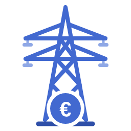

<h1 align="center">PVPC + Bono Social</h1>

<b>Spanish PVPC hourly prices and your electricity bill, to the cent, with or without the social bonus — for Home Assistant.</b> 
<a href="#english">English</a> · <a href="#español">Español</a> · <a href="https://github.com/BaRDaHL/pvpc_bonosocial/wiki">Wiki</a>

---

## English

Know **your electricity bill before it arrives**: PVPC hourly prices *plus* the regulated supplier's (COR) bill rebuilt line by line, with the **social bonus** (*bono social*), taxes and fixed charges.

### Why install it

- 🎯 **Accurate to the cent**: reproduces **21/21 real bills**; with a meter, **€0.45** average error per bill.
- 💡 **Full social bonus**: discount, yearly kWh limit, 12-month carry-over of unused kWh.
- ⚡ **Hourly prices today and tomorrow**: periods, price levels, cheapest hours, min/max/average and optional ESIOS private API.
- 📊 **Real cost in the Energy dashboard**, with taxes and fixed charges, corrected when the bill arrives.
- 📄 **Upload the PDF bill**: read locally, recalibrates the meter and the bonus balance.
- 🔍 **CNMC second opinion** of every bill (optional), with a Repairs notice if it does not match.
- 💶 **Compare tariffs** with the official CNMC comparator using what you *actually* paid and consumed.
- 📱 **Daily price summary** on Telegram or any notification.
- 🃏 **Built-in card** with today's and tomorrow's prices and the bill.
- 🔌 **Datadis** official readings (optional).
- 🔒 **Private**: runs locally; minimal anonymous data to the CNMC, only if you enable it.
- 📚 **Up to date**: every regulated value cites its source and validity dates; the BOE is checked weekly.

### Requirements

- **2.0TD** supply (up to 15 kW) on **PVPC**, mainland Spain or the Balearic Islands. In the Canary Islands, Ceuta and Melilla only the prices work (no bill).
- **Home Assistant 2025.11** or later.
- For the bill: an **hourly consumption source** (any energy sensor such as a Shelly EM, an external statistic or Datadis). Without it you still get all the prices.

### Install

1. **HACS → ⋮ → Custom repositories** → `https://github.com/BaRDaHL/pvpc_bonosocial` as **Integration** (or use the button above).
2. Download **PVPC + Bono Social** and restart Home Assistant.
3. **Settings → Devices & services → Add integration → PVPC + Bono Social.**
4. **Add supply** for your contract to get the bill, then add the **PVPC + Bono Social** card to a dashboard.

### Documentation

Step-by-step guides are in the **[Wiki](https://github.com/BaRDaHL/pvpc_bonosocial/wiki)**: [installation](https://github.com/BaRDaHL/pvpc_bonosocial/wiki/Installation) · [supply](https://github.com/BaRDaHL/pvpc_bonosocial/wiki/Supply) · [actual bills](https://github.com/BaRDaHL/pvpc_bonosocial/wiki/Actual-bills) · [card](https://github.com/BaRDaHL/pvpc_bonosocial/wiki/Card) · [Telegram summary](https://github.com/BaRDaHL/pvpc_bonosocial/wiki/Telegram-summary) · [Energy dashboard](https://github.com/BaRDaHL/pvpc_bonosocial/wiki/Energy-dashboard) · [compare tariffs](https://github.com/BaRDaHL/pvpc_bonosocial/wiki/Compare-tariffs) · [CNMC bill check](https://github.com/BaRDaHL/pvpc_bonosocial/wiki/CNMC-bill-check) · [Datadis](https://github.com/BaRDaHL/pvpc_bonosocial/wiki/Datadis) · [migration](https://github.com/BaRDaHL/pvpc_bonosocial/wiki/Migration) · [entities & services](https://github.com/BaRDaHL/pvpc_bonosocial/wiki/Entities-and-services) · [how it works](https://github.com/BaRDaHL/pvpc_bonosocial/wiki/How-it-works) · [FAQ](https://github.com/BaRDaHL/pvpc_bonosocial/wiki/FAQ)

### Compared with other integrations

| | Prices | Bill + social bonus | Holidays | Extras |
|---|---|---|---|---|
| **PVPC + Bono Social** | ✅ | ✅ | Circular 3/2020 rule + ESIOS tolls | Card, summary, CNMC check and comparator |
| Official `pvpc_hourly_pricing` | ✅ | ❌ | Fixed tables | |
| [Enchufado](https://github.com/Migux13/enchufado) | ✅ (own ESIOS token) | CNMC-simulated bill, no social bonus | — | Datadis consumption |

Reviewed in October 2026 by reading each integration's code.

### Help wanted

I can only test with my own data (one supplier, a 1st-gen Shelly EM, a Datadis account that returns nothing). If you have **PDF bills from another regulated supplier**, a **Shelly Gen2/Gen3** meter or a **Datadis account with data**, see [Volunteers](https://github.com/BaRDaHL/pvpc_bonosocial/wiki/Volunteers). Never post personal data in a public issue.

> Unofficial tool. The bill that counts is your supplier's; this integration estimates it and tells you before it arrives.

---

## Español

Sabe **tu factura de la luz antes de que llegue**: precios horarios del PVPC *y* la factura de la comercializadora de referencia (COR) rehecha línea a línea, con el **bono social**, los impuestos y los fijos.

### Por qué instalarla

- 🎯 **Exacta al céntimo**: reproduce **21 de 21 facturas reales**; con un medidor, **0,45 €** de error medio por factura.
- 💡 **Bono social completo**: descuento, límite anual de kWh y arrastre de los kWh no gastados en 12 meses.
- ⚡ **Precios por horas de hoy y mañana**: periodos, niveles de precio, horas más baratas, mínimo, máximo y media, y API privada de ESIOS opcional.
- 📊 **Coste real en el panel de Energía**, con impuestos y fijos, corregido al llegar la factura.
- 📄 **Sube el PDF de la factura**: se lee en local, recalibra el medidor y el saldo del bono.
- 🔍 **Segunda opinión de la CNMC** de cada factura (opcional), con aviso en Reparaciones si no cuadra.
- 💶 **Compara tarifas** con el comparador oficial de la CNMC usando lo que *de verdad* pagaste y consumiste.
- 📱 **Resumen diario de precios** por Telegram o cualquier notificación.
- 🃏 **Tarjeta propia** con los precios de hoy y mañana y la factura.
- 🔌 **Datadis**: lecturas oficiales del contador (opcional).
- 🔒 **Privada**: funciona en local; a la CNMC van datos mínimos y anónimos, solo si lo activas.
- 📚 **Al día**: cada valor regulado cita su fuente y sus fechas de vigencia; el BOE se revisa cada semana.

### Requisitos

- Suministro **2.0TD** (hasta 15 kW) con **PVPC**, en la **Península o Baleares**. En Canarias, Ceuta y Melilla solo funcionan los precios (sin factura).
- **Home Assistant 2025.11** o posterior.
- Para la factura, una **fuente de consumo horario** (un sensor de energía como un Shelly EM, una estadística externa o Datadis). Sin ella tienes igualmente todos los precios.

### Instalación

1. **HACS → ⋮ → Repositorios personalizados** → `https://github.com/BaRDaHL/pvpc_bonosocial` como **Integración** (o el botón de arriba).
2. Descarga **PVPC + Bono Social** y reinicia Home Assistant.
3. **Ajustes → Dispositivos y servicios → Añadir integración → PVPC + Bono Social.**
4. **Añadir suministro** con tu contrato para tener la factura, y pon la tarjeta **PVPC + Bono Social** en un panel.

### Documentación

Las guías paso a paso están en la **[Wiki](https://github.com/BaRDaHL/pvpc_bonosocial/wiki/ES-Inicio)**: [instalación](https://github.com/BaRDaHL/pvpc_bonosocial/wiki/ES-Instalacion) · [suministro](https://github.com/BaRDaHL/pvpc_bonosocial/wiki/ES-Suministro) · [facturas reales](https://github.com/BaRDaHL/pvpc_bonosocial/wiki/ES-Facturas) · [tarjeta](https://github.com/BaRDaHL/pvpc_bonosocial/wiki/ES-Tarjeta) · [resumen por Telegram](https://github.com/BaRDaHL/pvpc_bonosocial/wiki/ES-Resumen-Telegram) · [panel de Energía](https://github.com/BaRDaHL/pvpc_bonosocial/wiki/ES-Panel-de-Energia) · [comparar tarifas](https://github.com/BaRDaHL/pvpc_bonosocial/wiki/ES-Comparar-tarifas) · [comprobación con la CNMC](https://github.com/BaRDaHL/pvpc_bonosocial/wiki/ES-Comprobacion-CNMC) · [Datadis](https://github.com/BaRDaHL/pvpc_bonosocial/wiki/ES-Datadis) · [migración](https://github.com/BaRDaHL/pvpc_bonosocial/wiki/ES-Migracion) · [entidades y servicios](https://github.com/BaRDaHL/pvpc_bonosocial/wiki/ES-Entidades-y-servicios) · [cómo se calcula](https://github.com/BaRDaHL/pvpc_bonosocial/wiki/ES-Como-se-calcula) · [preguntas frecuentes](https://github.com/BaRDaHL/pvpc_bonosocial/wiki/ES-Preguntas-frecuentes)

La comparativa con otras integraciones está [arriba, en la parte en inglés](#compared-with-other-integrations).

### Se buscan voluntarios

Solo puedo probar con mis datos (una comercializadora, un Shelly EM de 1.ª generación y una cuenta de Datadis que no devuelve nada). Si tienes **facturas en PDF de otra comercializadora de referencia**, un **Shelly Gen2/Gen3** o una **cuenta de Datadis con datos**, mira [Voluntarios](https://github.com/BaRDaHL/pvpc_bonosocial/wiki/ES-Voluntarios). Nunca subas datos personales a una incidencia pública.

> Herramienta no oficial. La factura que vale es la de tu comercializadora; esta integración la estima y te avisa antes de que llegue.

---

**Credits / Créditos:** built on the work of many people — see [CREDITS.md](CREDITS.md). **License / Licencia:** MIT © 2026 BaRDaHL ([LICENSE](LICENSE), third-party notices in [NOTICE](NOTICE)).
