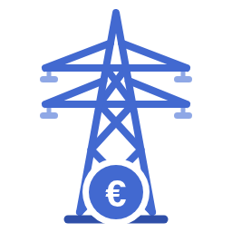

<h1 align="center">PVPC + Bono Social</h1>

<b>Precios horarios del PVPC y tu factura de la luz, al céntimo, con o sin bono social, en Home Assistant.</b> 
Spanish PVPC hourly prices and your electricity bill, to the cent, with or without the social bonus. 
<a href="https://github.com/BaRDaHL/pvpc_bonosocial/wiki/ES-Inicio">Wiki</a>

---

Conoce **tu factura de la luz antes de que llegue**: precios horarios del PVPC *y* la factura de la comercializadora de referencia (COR) rehecha línea a línea, con el **bono social**, los impuestos y los fijos.

### Por qué instalarla

- 🎯 **Exacta al céntimo**: reproduce **21 de 21 facturas reales** (de diciembre de 2024 a septiembre de 2026). Con un medidor en casa, la factura estimada se desvió **0,45 € de media** en 8 facturas.
- 💡 **Bono social completo**: descuento, límite anual de kWh y arrastre de los kWh no gastados en 12 meses.
- ⚡ **Precios por horas de hoy y mañana**: periodos, niveles de precio, horas más baratas, mínimo, máximo y media, y API privada de ESIOS opcional.
- 📊 **Coste real en el panel de Energía**, con impuestos y fijos, corregido al llegar la factura.
- 📄 **Sube el PDF de la factura**: se lee en local, recalibra el medidor y el saldo del bono.
- 🔍 **Segunda opinión de la CNMC** de cada factura (opcional), con aviso en Reparaciones si no cuadra.
- 💶 **Compara tarifas** con el comparador oficial de la CNMC usando lo que *de verdad* pagaste y consumiste. Desde la tarjeta, con las 5 mejores ofertas, enlace a la ficha de cada una y al listado completo de la CNMC con tus datos, y la previsión del PVPC para el año que viene.
- 📱 **Resumen diario de precios** por Telegram (necesita la integración [Telegram bot](https://www.home-assistant.io/integrations/telegram_bot/) configurada en Home Assistant) o cualquier notificación.
- 🃏 **Tarjeta propia**: precios de hoy y mañana, la factura, la evolución de tus facturas y la comparativa de tarifas.
- 🔌 **Datadis**: lecturas oficiales del contador (opcional).
- 🔒 **Privada**: funciona en local; a la CNMC van datos mínimos y anónimos, solo si lo activas.
- 📚 **Al día**: cada valor regulado cita su fuente y sus fechas de vigencia; el BOE se revisa cada semana.

### Requisitos

- **Home Assistant 2025.11** o posterior. Con eso ya tienes **los precios del PVPC**, tengas la tarifa que tengas.
- **Para la factura** (opcional):
  - suministro **2.0TD** (hasta 15 kW) con **PVPC**, en la **Península o Baleares** (en Canarias, Ceuta y Melilla solo hay precios);
  - una **fuente de consumo horario**: un sensor de energía (un Shelly EM, por ejemplo), una estadística externa o Datadis.

### Instalación

Está en la tienda oficial de **HACS**: no hace falta añadir ningún repositorio personalizado.

1.  — o busca **PVPC + Bono Social** en HACS.
2. **Descárgala** y reinicia Home Assistant.
3.  — o **Ajustes → Dispositivos y servicios → Añadir integración → PVPC + Bono Social.**
4. **Añadir suministro** con tu contrato para tener la factura, y pon la tarjeta **PVPC + Bono Social** en un panel.

### Documentación

Todas las guías, paso a paso, en la **[wiki](https://github.com/BaRDaHL/pvpc_bonosocial/wiki/ES-Inicio)**. Para empezar: [instalación](https://github.com/BaRDaHL/pvpc_bonosocial/wiki/ES-Instalacion) · [suministro](https://github.com/BaRDaHL/pvpc_bonosocial/wiki/ES-Suministro) · [tarjeta](https://github.com/BaRDaHL/pvpc_bonosocial/wiki/ES-Tarjeta) · [comparar tarifas](https://github.com/BaRDaHL/pvpc_bonosocial/wiki/ES-Comparar-tarifas).

### Comparativa con otras integraciones

| | Precios | Factura + bono social | Festivos | Extras |
|---|---|---|---|---|
| **PVPC + Bono Social** | ✅ | ✅ | Regla de la Circular 3/2020 + peajes de ESIOS | Tarjeta, resumen por Telegram, comprobación de facturas con la CNMC y comparativa de tarifas con enlaces |
| Oficial `pvpc_hourly_pricing` | ✅ | ❌ | Tablas fijas | |
| [PVPC Next](https://github.com/privatecoder/ha-pvpc-next) | ✅ | ❌ | Calculados | Base de la parte de precios de esta integración |
| [Enchufado](https://github.com/Migux13/enchufado) | ✅ (token propio de ESIOS) | Factura simulada por la CNMC, sin bono social | — | Consumo de Datadis |

Revisado en octubre de 2026 leyendo el código de cada integración.

### Se buscan voluntarios

Solo puedo probar con mis datos (una comercializadora, un Shelly EM de 1.ª generación y una cuenta de Datadis que no devuelve nada). Si tienes **facturas en PDF de otra comercializadora de referencia**, un **Shelly Gen2/Gen3** o una **cuenta de Datadis con datos**, mira [Voluntarios](https://github.com/BaRDaHL/pvpc_bonosocial/wiki/ES-Voluntarios). Nunca subas datos personales a una incidencia pública.

### Apoya el proyecto

Es gratis y lo seguirá siendo. Si te ahorra dinero o tiempo, puedes [invitarme a un café ☕](https://buymeacoffee.com/bardahl).

> Herramienta no oficial. La factura que vale es la de tu comercializadora; esta integración la estima y te avisa antes de que llegue.

---

Know **your electricity bill before it arrives**: PVPC hourly prices *plus* the regulated supplier's (COR) bill rebuilt line by line, with the **social bonus** (*bono social*), taxes and fixed charges.

### Why install it

- 🎯 **Accurate to the cent**: reproduces **21/21 real bills** (December 2024 to September 2026). With a meter at home, the estimated bill was off by **€0.45 on average** over 8 bills.
- 💡 **Full social bonus**: discount, yearly kWh limit, 12-month carry-over of unused kWh.
- ⚡ **Hourly prices today and tomorrow**: periods, price levels, cheapest hours, min/max/average and optional ESIOS private API.
- 📊 **Real cost in the Energy dashboard**, with taxes and fixed charges, corrected when the bill arrives.
- 📄 **Upload the PDF bill**: read locally, recalibrates the meter and the bonus balance.
- 🔍 **CNMC second opinion** of every bill (optional), with a Repairs notice if it does not match.
- 💶 **Compare tariffs** with the official CNMC comparator using what you *actually* paid and consumed. From the card, with the top 5 offers, links to each offer sheet and to the full CNMC list with your data, and the PVPC forecast for next year.
- 📱 **Daily price summary** on Telegram (needs the [Telegram bot](https://www.home-assistant.io/integrations/telegram_bot/) integration set up in Home Assistant) or any notification.
- 🃏 **Built-in card**: today's and tomorrow's prices, the bill, your bills over time and the tariff comparison.
- 🔌 **Datadis** official readings (optional).
- 🔒 **Private**: runs locally; minimal anonymous data to the CNMC, only if you enable it.
- 📚 **Up to date**: every regulated value cites its source and validity dates; the BOE is checked weekly.

### Requirements

- **Home Assistant 2025.11** or later. That is enough for **the PVPC prices**, whatever your tariff.
- **For the bill** (optional):
  - a **2.0TD** supply (up to 15 kW) on **PVPC**, in mainland Spain or the Balearic Islands (the Canary Islands, Ceuta and Melilla get prices only);
  - an **hourly consumption source**: an energy sensor (a Shelly EM, for example), an external statistic or Datadis.

### Install

It is in the **HACS** default store: no custom repository needed.

1.  — or search **PVPC + Bono Social** in HACS.
2. **Download** it and restart Home Assistant.
3.  — or **Settings → Devices & services → Add integration → PVPC + Bono Social.**
4. **Add supply** for your contract to get the bill, then add the **PVPC + Bono Social** card to a dashboard.

### Documentation

All step-by-step guides are in the **[wiki](https://github.com/BaRDaHL/pvpc_bonosocial/wiki)**. To get started: [installation](https://github.com/BaRDaHL/pvpc_bonosocial/wiki/Installation) · [supply](https://github.com/BaRDaHL/pvpc_bonosocial/wiki/Supply) · [card](https://github.com/BaRDaHL/pvpc_bonosocial/wiki/Card) · [compare tariffs](https://github.com/BaRDaHL/pvpc_bonosocial/wiki/Compare-tariffs).

### Compared with other integrations

| | Prices | Bill + social bonus | Holidays | Extras |
|---|---|---|---|---|
| **PVPC + Bono Social** | ✅ | ✅ | Circular 3/2020 rule + ESIOS tolls | Card, Telegram summary, CNMC bill check and tariff comparison with links |
| Official `pvpc_hourly_pricing` | ✅ | ❌ | Fixed tables | |
| [PVPC Next](https://github.com/privatecoder/ha-pvpc-next) | ✅ | ❌ | Computed | Base of the price layer here |
| [Enchufado](https://github.com/Migux13/enchufado) | ✅ (own ESIOS token) | CNMC-simulated bill, no social bonus | — | Datadis consumption |

Reviewed in October 2026 by reading each integration's code.

### Help wanted

I can only test with my own data (one supplier, a 1st-gen Shelly EM, a Datadis account that returns nothing). If you have **PDF bills from another regulated supplier**, a **Shelly Gen2/Gen3** meter or a **Datadis account with data**, see [Volunteers](https://github.com/BaRDaHL/pvpc_bonosocial/wiki/Volunteers). Never post personal data in a public issue.

### Support

It is free and always will be. If it saves you money or time, you can [buy me a coffee ☕](https://buymeacoffee.com/bardahl).

> Unofficial tool. The bill that counts is your supplier's; this integration estimates it and tells you before it arrives.

---

**Créditos / Credits:** hecha sobre el trabajo de mucha gente / built on the work of many people — [CREDITS.md](CREDITS.md). **Licencia / License:** MIT © 2026 BaRDaHL ([LICENSE](LICENSE); avisos de terceros / third-party notices: [NOTICE](NOTICE)).
